# Desarrollo de una API REST para la gestión de usuarios y streamers favoritos de Twitch

**Autora:** Alba Bigarella Martínez  
**Curso académico:** 2026-2027  
**Formación:** Máster en Desarrollo de Aplicaciones Web

---

## Índice

1. [Introducción](#1-introducción)
2. [Objetivos](#2-objetivos)
3. [Análisis del proyecto](#3-análisis-del-proyecto)
    3.1. [Estructura del proyecto](#31-estructura-del-proyecto)
    3.2. [Flujo del proyecto](#32-flujo-del-proyecto)
4. [Desarrollo del proyecto](#4-desarrollo-del-proyecto)
    4.1. [Preparación del entorno de trabajo](#41-preparación-del-entorno-de-trabajo)
    4.2. [Base de datos con MySQL](#42-base-de-datos-con-mysql)
    4.3. [Desarrollo de la API](#43-desarrollo-de-la-api)
5. [Pruebas](#5-pruebas)
    5.1. [Gestión de usuarios](#51-gestión-de-usuarios)
    5.2. [Gestión de streamers favoritos](#52-gestión-de-streamers-favoritos)
    5.3. [Consulta de información de streamers](#53-consulta-de-información-de-streamers)
    5.4. [Comprobación de la base de datos en MySQL Workbench](#54-comprobación-de-la-base-de-datos-en-mysql-workbench)
6. [Observaciones](#6-observaciones)
7. [Conclusiones](#7-conclusiones)

---

# 1. Introducción

El objetivo de este proyecto es desarrollar una API REST utilizando Python y FastAPI que permita gestionar usuarios y sus streamers favoritos de la plataforma Twitch.

La aplicación permite realizar operaciones CRUD (*Create, Read, Update, Delete*) sobre los usuarios registrados, así como gestionar sus preferencias de streamers. Además, se conecta con la API oficial de Twitch para obtener información actualizada sobre los streamers, incluyendo sus datos públicos y su estado de actividad.

Para almacenar la información se ha utilizado una base de datos relacional MySQL. De esta manera, los datos de los usuarios y sus streamers favoritos permanecen almacenados y pueden consultarse o modificarse mediante las diferentes operaciones de la API.

El desarrollo se ha organizado en diferentes módulos, separando la configuración, los modelos de datos, las rutas y la comunicación con servicios externos. Esta organización permite mantener el código estructurado y facilita su mantenimiento y ampliación.

Por último, se han realizado pruebas de funcionamiento mediante Bruno, comprobando tanto las operaciones habituales como diferentes situaciones de error, y se ha verificado que las modificaciones realizadas a través de la API se reflejan correctamente en la base de datos.

# 2. Objetivos

El objetivo principal es desarrollar una API REST funcional que permita gestionar usuarios y sus streamers favoritos, integrando una base de datos MySQL y la API externa de Twitch.

Para conseguirlo, se han establecido los siguientes objetivos específicos:

- Crear una API REST utilizando FastAPI.
- Implementar las operaciones CRUD para la gestión de usuarios.
- Diseñar una base de datos MySQL para almacenar usuarios y sus streamers favoritos.
- Establecer una relación entre usuarios y streamers favoritos.
- Permitir que cada usuario pueda añadir, consultar y eliminar sus streamers favoritos.
- Integrar la API oficial de Twitch para consultar información de los streamers.
- Comprobar si los streamers favoritos se encuentran en directo.
- Validar los datos recibidos en las peticiones para evitar registros incorrectos.
- Gestionar adecuadamente los errores, devolviendo respuestas HTTP.
- Realizar pruebas de los diferentes endpoints para verificar el correcto funcionamiento de la aplicación.
- Documentar el desarrollo y los resultados obtenidos.

# 3. Análisis del proyecto

Antes de comenzar con la implementación, se ha definido una estructura modular para organizar los diferentes componentes de la aplicación y evitar concentrar toda la lógica en un único archivo.

El proyecto combina tres elementos principales:

- **FastAPI:** se encarga de recibir las peticiones HTTP, procesarlas y devolver las respuestas correspondientes.
- **MySQL:** almacena la información persistente de los usuarios y sus streamers favoritos.
- **Twitch API:** proporciona información externa sobre los streamers registrados como favoritos o consultados mediante la aplicación.

## Repositorio de GitHub

El código fuente del proyecto se encuentra disponible en el siguiente repositorio de GitHub:

**[Twitch API – GitHub Repository](https://github.com/abigarella-dev/master-02-assignment-01-rest-api)**

## 3.1. Estructura del proyecto

El proyecto se ha organizado en diferentes carpetas y archivos. La estructura general es la siguiente:

```text
proyecto/
│
├── main.py
│
├── configuration/
│   ├── __init__.py
│   ├── config.py
│   └── database.py
│
├── models/
│   ├── __init__.py
│   ├── users.py
│   └── favorites.py
│
├── routers/
│   ├── __init__.py
│   ├── users.py
│   ├── streamers.py
│   └── twitch.py
│
├── services/
│   └── twitch_client.py
│
├── sql-scripts/
│   ├── 01-create-database.sql
│   ├── 02-create-tables.sql
│   ├── 03-users-created.sql
│   └── 04-favorite-streamers.sql
│
├── .env
├── .env.template
├── .gitignore
└── requirements.txt
```

La organización de los archivos responde a las siguientes responsabilidades:

| Archivo / Carpeta | Descripción |
|---|---|
| `main.py` | Archivo principal de la aplicación, crea la instancia de FastAPI y registra los diferentes routers para habilitar los endpoints de la API. |
| `configuration/config.py` | Lee las variables de entorno definidas en el archivo `.env` y las pone a disposición del resto de la aplicación. |
| `configuration/database.py` | Gestiona la conexión con la base de datos MySQL mediante una función reutilizable. |
| `models/users.py` | Define los modelos Pydantic relacionados con los usuarios. |
| `models/favorites.py` | Define los modelos Pydantic relacionados con los streamers favoritos y la información obtenida desde Twitch. |
| `routers/users.py` | Gestiona las operaciones CRUD de los usuarios. |
| `routers/streamers.py` | Gestiona la creación, consulta y eliminación de los streamers favoritos de cada usuario. |
| `routers/twitch.py` | Proporciona endpoints para consultar la información y el estado de conexión de los streamers en Twitch. |
| `services/twitch_client.py` | Gestiona la autenticación y las peticiones a la API oficial de Twitch para obtener información de los streamers. |
| `sql-scripts/` | Carpeta para almacenar los scripts SQL utilizados para crear y configurar la base de datos. |
| `.env` | Archivo que contiene las variables de entorno privadas, como las credenciales de MySQL y Twitch. |
| `.env.template` | Plantilla que muestra las variables de entorno necesarias para configurar el proyecto, sin incluir credenciales reales. |
| `.gitignore` | Define los archivos y carpetas que Git debe ignorar, evitando que se suban elementos privados o innecesarios al repositorio. |
| `requirements.txt` | Contiene las dependencias de Python necesarias para ejecutar el proyecto. |

## 3.2. Flujo del proyecto

El funcionamiento general de la aplicación comienza cuando un cliente realiza una petición HTTP a uno de los endpoints disponibles. En función del recurso solicitado, la API ejecuta las operaciones necesarias y devuelve una respuesta en formato JSON.

El flujo general es el siguiente:

```text
main.py
  ├── routers/users.py
  │     ├── configuration/database.py ── configuration/config.py ── .env
  │     └── models/users.py
  ├── routers/streamers.py
  │     ├── configuration/database.py
  │     ├── models/favorites.py
  │     └── services/twitch_client.py ── configuration/config.py ── .env
  └── routers/twitch.py
        ├── configuration/database.py
        ├── models/favorites.py
        └── services/twitch_client.py
```

Como se puede observar, cada router utiliza los módulos que necesita para realizar sus operaciones. Los routers de usuarios y streamers favoritos utilizan `database.py` para acceder a MySQL, mientras que los modelos de la carpeta `models/` permiten validar los datos recibidos y estructurar las respuestas.

Por otro lado, los endpoints relacionados con Twitch se agrupan en `twitch_client.py`, que se encarga de gestionar la autenticación y las peticiones a la API externa. Aquí se obtienen las credenciales necesarias desde `config.py`, que a su vez las lee del archivo `.env`.

# 4. Desarrollo del proyecto

## 4.1. Preparación del entorno de trabajo

### Creación del entorno virtual

Se ha creado un entorno virtual de Python y se ha activado utilizando los siguientes comandos en la terminal:

```bash
python -m venv .venv
source .venv/bin/activate
```

Las dependencias de las librerías instaladas se han recogido posteriormente en el archivo `requirements.txt`, utilizando:

```bash
pip freeze > requirements.txt
```

### Organización del proyecto con Git

Para llevar a cabo el control de versiones del proyecto, se ha utilizado Git. Se ha creado una rama independiente de trabajo para desarrollar la funcionalidad sin modificar directamente la rama principal. Los comandos utilizados para ello son lo siguientes:

```bash
git clone https://github.com/usuario/master-02-assignment-01-rest-api.git
git switch -c feature/rest-api
```

### Tecnologías y herramientas seleccionadas

**FastAPI**

Se ha escogido FastAPI como framework para desarrollar la API REST debido a su integración con Python, su facilidad de uso y su sistema de validación de datos mediante Pydantic.

**MySQL**

Se ha escogido MySQL para la gestión de bases de datos porque permite almacenar información estructurada y establecer relaciones entre diferentes tablas. Además, se ha utilizado MySQL Workbench como herramienta para administrar y consultar la base de datos.

**Bruno**

Se ha utilizado Bruno como herramienta para realizar pruebas de las peticiones HTTP a la API. Permite configurar solicitudes GET, POST, PATCH y DELETE, introducir parámetros y cuerpos JSON, enviar las peticiones y comprobar las respuestas obtenidas.

### Configuración de las variables de entorno

Para evitar incluir credenciales directamente en el código, se ha utilizado un archivo `.env` donde se almacenan los datos de conexión con MySQL y las credenciales necesarias para acceder a Twitch. Además, se ha creado el archivo `.env.template` para indicar qué variables deben configurarse al ejecutar el proyecto para no tener que incluir las credenciales reales por motivo de seguridad. Por ello, el archivo `.env` se ha añadido a `.gitignore` para evitar que se publique en el repositorio.

## 4.2. Base de datos con MySQL

Para almacenar la información de la aplicación se ha creado una base de datos en MySQL denominada `twitch_api`.

El diseño contempla dos tablas principales:

- `users`: almacena los usuarios registrados en la aplicación.
- `favorite_streamers`: almacena los streamers favoritos asociados a cada usuario.

### Creación de la base de datos

En primer lugar, se ha creado la base de datos mediante un script SQL independiente. Se ha utilizado `IF NOT EXISTS` para evitar errores si la base de datos ya existe.

```sql
CREATE DATABASE IF NOT EXISTS twitch_api;
USE twitch_api;
```

### Creación de la tabla de usuarios

La tabla `users` almacena la información básica de los usuarios. Esta tabla se ha creado siguiendo el siguiente código:

```sql
CREATE TABLE IF NOT EXISTS users (
    id INT AUTO_INCREMENT PRIMARY KEY,
    username VARCHAR(50) NOT NULL UNIQUE,
    email VARCHAR(255) NOT NULL UNIQUE,
    created_at TIMESTAMP DEFAULT CURRENT_TIMESTAMP
);
```

Sus campos son:

| Campo | Tipo | Descripción |
|---|---|---|
| id | INT | Identificador único del usuario. |
| username | VARCHAR(50) | Nombre de usuario. |
| email | VARCHAR(255) | Dirección de correo electrónico. |
| created_at | TIMESTAMP | Fecha y hora de creación del registro. |

El campo `id` se ha definido como clave primaria con incremento automático (`AUTO_INCREMENT`). Además, los campos `username` y `email` tienen una restricción `UNIQUE` para evitar que dos usuarios puedan registrarse con el mismo nombre de usuario o dirección de correo electrónico. Por último, el campo `created_at` registra automáticamente la fecha de creación del usuario mediante `CURRENT_TIMESTAMP`.

### Creación de la tabla de streamers favoritos

La tabla `favorite_streamers` almacena los streamers que cada usuario añade a su lista de favoritos. Esta tabla se ha creado siguiendo el siguiente código:

```sql
CREATE TABLE IF NOT EXISTS favorite_streamers (
    id INT AUTO_INCREMENT PRIMARY KEY,
    user_id INT NOT NULL,
    twitch_login VARCHAR(25) NOT NULL,
    created_at TIMESTAMP DEFAULT CURRENT_TIMESTAMP,
    UNIQUE KEY unique_user_streamer (user_id, twitch_login),
    CONSTRAINT foreign_favorites_user
        FOREIGN KEY (user_id) REFERENCES users(id)
        ON DELETE CASCADE
);
```

Sus campos son:

| Campo | Tipo | Descripción |
|---|---|---|
| id | INT | Identificador único del favorito. |
| user_id | INT | Identificador del usuario al que pertenece. |
| twitch_login | VARCHAR(25) | Nombre de inicio de sesión del streamer en Twitch. |
| created_at | TIMESTAMP | Fecha y hora en la que se añadió el favorito. |

El campo `user_id` es una clave foránea que referencia al campo `id` de la tabla `users` para que cada streamer favorito queda asociado a un usuario existente. Además, para que un usuario no añada dos veces al mismo streamer, se ha estabecido un `UNIQUE KEY` a `user_id` y `twitch_login`. Por último, se ha definido la opción `ON DELETE CASCADE` en la relación entre tablas para que al eliminar un usuario, se elimine automáticamente la información de sus streamers favoritos, evitando así que queden datos relacionados con el usuario.

## 4.3. Desarrollo de la API

Una vez configurada la base de datos y el entorno de trabajo, se procedió al desarrollo de la API utilizando FastAPI. La aplicación se organizó en diferentes carpetas para separar la gestión de usuarios, los streamers favoritos, la comunicación con Twitch y la validación de los datos.

#### 4.3.1. Configuración principal de la aplicación

El archivo `main.py` es el punto de entrada de la API en el que se crea la instancia de FastAPI, se define el título y la descripción de la aplicación y se registran los diferentes routers.

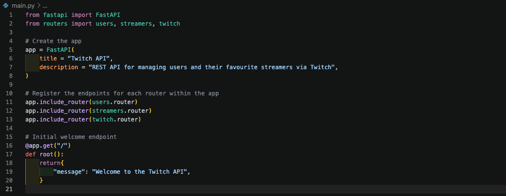

#### 4.3.2. Gestión de usuarios

La gestión de usuarios se implementó en el archivo `routers/users.py`, donde se definieron los endpoints necesarios para realizar las operaciones CRUD (*Create, Read, Update and Delete*).

Las funcionalidades desarrolladas son:

- **Crear un usuario:** permite registrar un nuevo usuario en la base de datos mediante una petición `POST`. Si el usuario se crea correctamente, devuelve sus datos con un código de estado `201`.

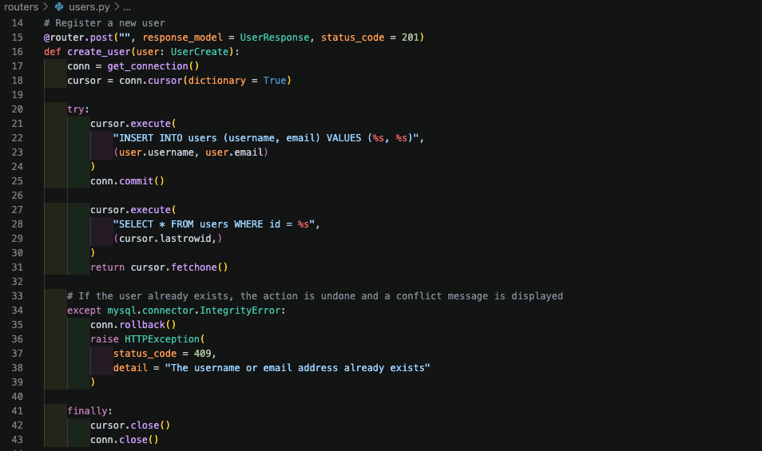

- **Consultar todos los usuarios:** permite obtener la lista completa de usuarios registrados mediante una petición `GET`.

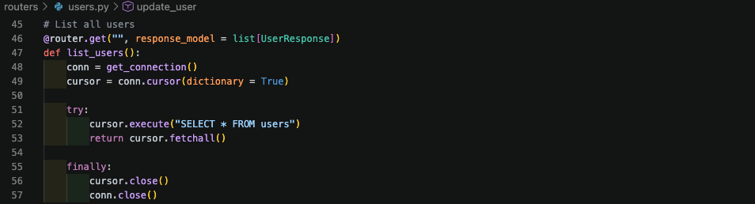

- **Consultar un usuario:** permite obtener la información de un usuario concreto a partir de su identificador.

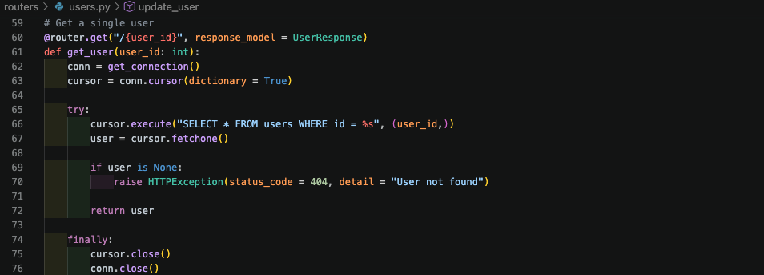

- **Actualizar un usuario:** permite modificar parcialmente los datos de un usuario mediante una petición `PATCH`. Solo se actualizan los campos enviados en la petición.

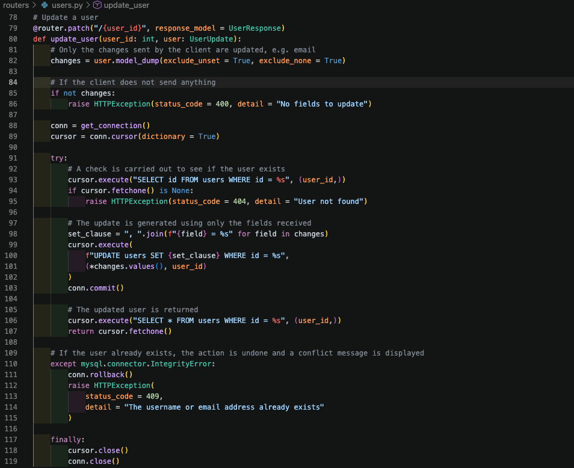

- **Eliminar un usuario:** permite eliminar un usuario mediante su identificador. Si la operación se realiza correctamente, devuelve el código de estado `204`.

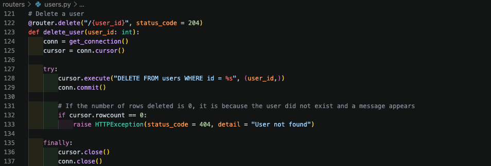

Para evitar errores se añadieron diferentes comprobaciones como, por ejemplo, no se permite registrar dos usuarios con el mismo nombre de usuario o correo electrónico. En estos casos, la API devuelve un código `409 Conflict`. También se comprueba que el usuario exista antes de consultarlo o actualizarlo. Si no se encuentra, se devuelve un código `404 Not Found`. En las actualizaciones, se comprueba que se haya enviado al menos un campo válido. Si la petición no contiene ningún dato que modificar, se devuelve un código `400 Bad Request`.

#### 4.3.3. Gestión de streamers favoritos

La gestión de los streamers favoritos se desarrolló en el archivo `routers/streamers.py`. Cada streamer favorito está asociado a un usuario mediante su identificador. Para añadir un favorito, la API realiza las siguientes comprobaciones:

1. Se comprueba que el usuario existe en la base de datos.

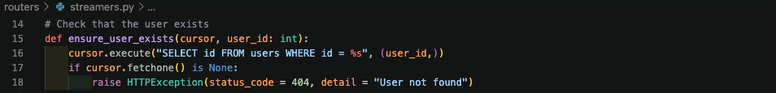

2. Se verifica que el nombre de usuario del streamer cumple con el formato establecido.

3. Se consulta la API de Twitch para comprobar que el streamer existe. Si se intenta añadir un streamer que ya está registrado como favorito, la API devuelve un código `409 Conflict`. Si el streamer no existe en Twitch, devuelve un código `404 Not Found`. Además, El nombre de usuario de Twitch se convierte a minúsculas para evitar diferencias entre nombres escritos con mayúsculas y minúsculas. 

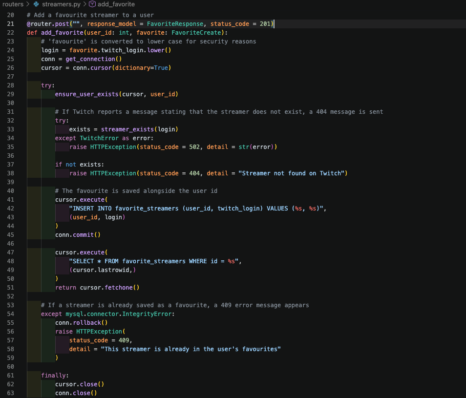

4. Si todas las comprobaciones son correctas se guarda el streamer favorito en MySQL.

Además, se implementaron los siguientes endpoints:

5. Consultar favoritos: devuelve la lista de streamers favoritos de un usuario, ordenada por fecha de creación.

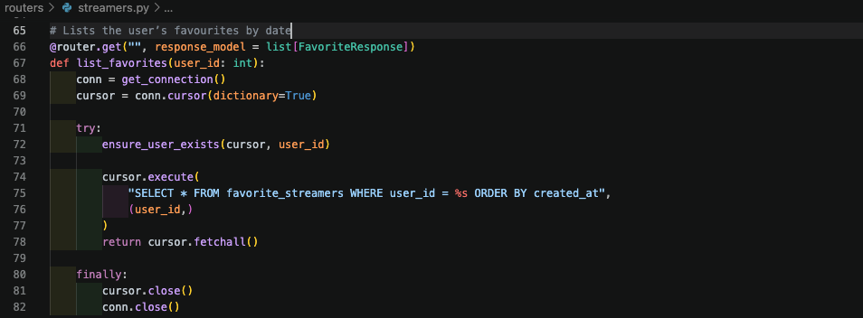

6. Eliminar un favorito: permite eliminar un streamer de la lista de favoritos de un usuario.

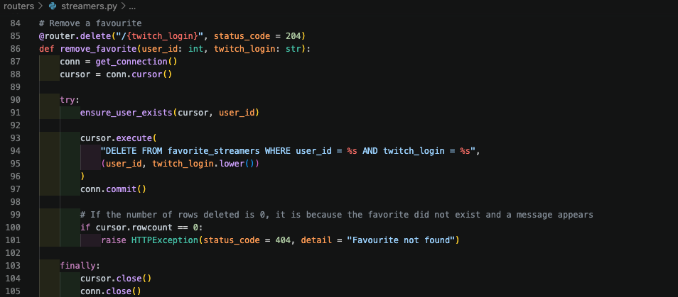

#### 4.3.4. Consulta de información de Twitch

El archivo `routers/twitch.py` contiene los endpoints que se encargan de consultar información de los streamers directamente desde Twitch.

Se desarrollaron dos funcionalidades principales:

1. Consultar un streamer: permite obtener información de un streamer concreto a partir de su nombre de usuario de Twitch.

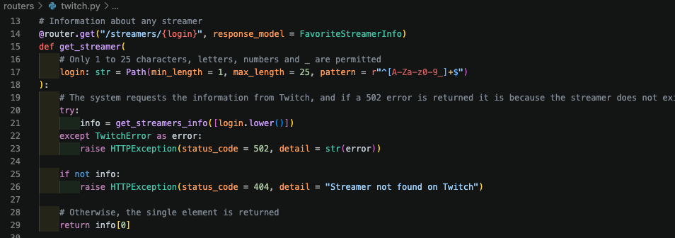

2. Consultar el estado de los favoritos: permite obtener información de todos los streamers favoritos de un usuario incluyendo su estado de conexión.

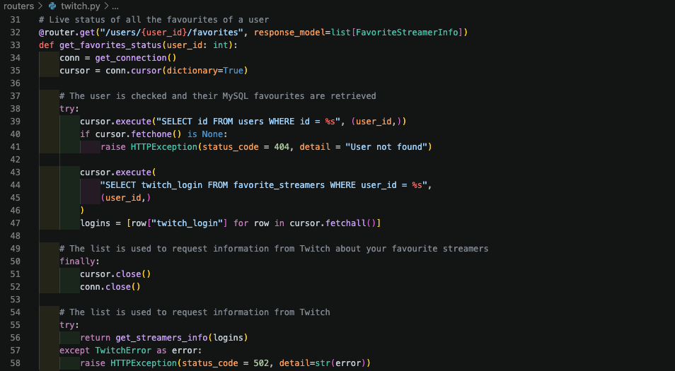

Para consultar los favoritos, primero se comprueba que el usuario existe en MySQL y se recuperan los nombres de sus streamers favoritos y, después, estos nombres se utilizan para solicitar información actualizada a Twitch. De esta manera cuando un streamer está transmitiendo en directo también se devuelve el título de la transmisión. 

#### 4.3.5. Comunicación con la API de Twitch

La comunicación con Twitch se agrupó en el archivo `services/twitch_client.py`. Para acceder a la API oficial de Twitch se utiliza un sistema de autenticación mediante un App Access Token. Este token se obtiene utilizando las credenciales de la aplicación, que se encuentran almacenadas en el archivo `.env`.

Este archivo implementa las siguientes funcionalidades:

- Solicitar un token de acceso a Twitch.

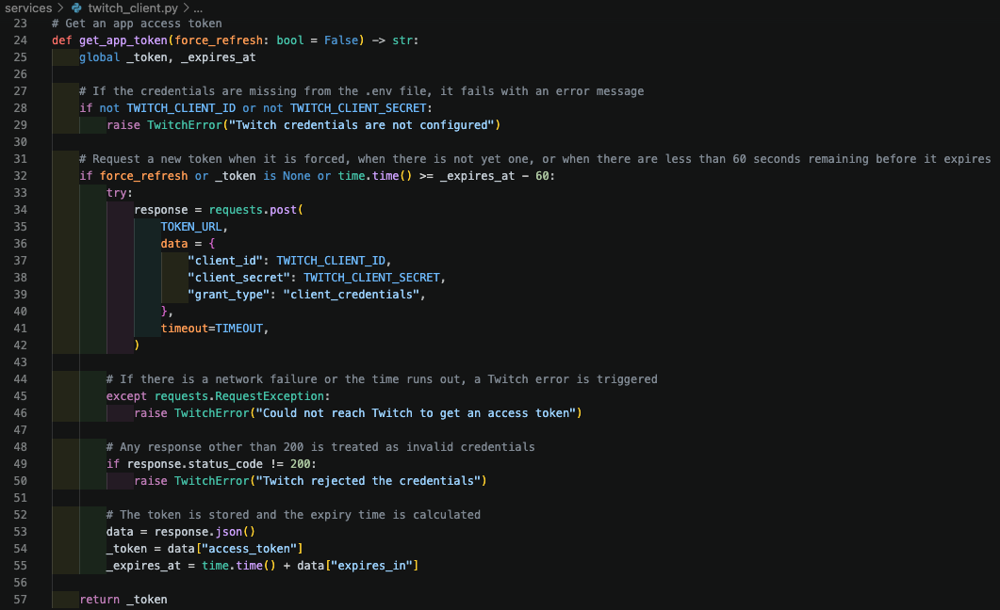

Este token se almacena temporalmente el token para evitar solicitar uno nuevo en cada petición y se renueva cuando está próximo a caducar. Además, se reintentar una petición si Twitch devuelve un código `401 Unauthorized`, solicitando previamente un nuevo token.

- Consultar qué streamers se encuentran transmitiendo en directo.

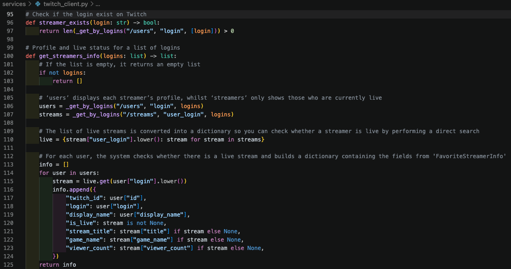

Las peticiones se realizan utilizando la biblioteca `requests`, estableciendo un tiempo máximo de espera de 10 segundos para evitar que la aplicación quede esperando indefinidamente una respuesta.

También se implementó un sistema para realizar consultas por bloques de hasta 100 nombres de usuario, respetando el límite de logins establecido para las peticiones a Twitch.

Para combinar la información obtenida, se consultan los perfiles de los usuarios y, por separado, los streamers que están transmitiendo en directo. Posteriormente, ambas respuestas se relacionan mediante el nombre de usuario, permitiendo determinar si cada streamer está conectado.

#### 4.3.6. Validación de datos y gestión de errores

En el archivo `models/users.py` se establecieron los modelos para crear, actualizar y devolver información de los usuarios. Se aplicaron restricciones al nombre de usuario y se utilizó `EmailStr` para validar el formato del correo electrónico. Por otro lado, en `models/favorites.py` se definieron los modelos relacionados con los streamers favoritos. El nombre de usuario de Twitch debe tener entre 1 y 25 caracteres y únicamente puede contener letras, números y guiones bajos. Además, se implementó un validador que convierte automáticamente el nombre de usuario de Twitch a minúsculas.

También se añadieron mecanismos de gestión de errores para devolver respuestas HTTP adecuadas en función del problema encontrado:

| Código HTTP | Descripción |
|---|---|
| `201 Created` | El usuario o streamer favorito se ha creado correctamente. |
| `204 No Content` | El usuario o streamer favorito se ha eliminado correctamente. |
| `400 Bad Request` | La petición no contiene datos válidos para realizar una actualización. |
| `404 Not Found` | El usuario, streamer o favorito solicitado no existe. |
| `409 Conflict` | Se intenta registrar un usuario o favorito que ya existe. |
| `502 Bad Gateway` | Se ha producido un error al comunicarse con Twitch. |
| `503 Service Unavailable` | No se ha podido establecer conexión con la base de datos. |

# 5. Pruebas

Una vez finalizado el desarrollo, se han realizado diferentes pruebas utilizando Bruno para comprobar el funcionamiento de los endpoints. Se han probado tanto las operaciones habituales como diferentes situaciones de error, verificando que la API responde correctamente y que los datos se almacenan o modifican según lo esperado.

## 5.1. Gestión de usuarios

### 5.1.1. Crear usuario

Se realiza una petición POST para registrar un nuevo usuario. En el cuerpo de la petición se envían los datos necesarios en formato JSON, como el nombre de usuario y el correo electrónico.

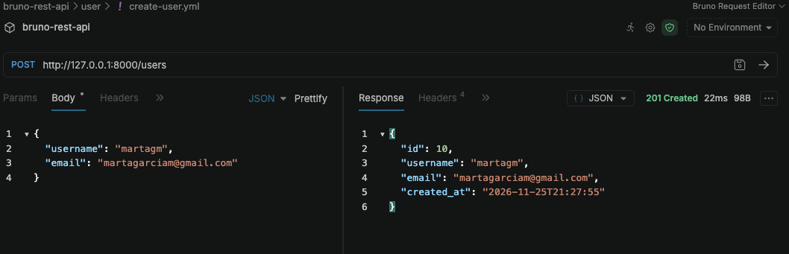

Si se intenta registrar un usuario utilizando un nombre de usuario o correo electrónico que ya existe en la base de datos, la API detecta la duplicidad y devuelve un error adecuado sin crear un nuevo registro.


Si se envían datos que no cumplen las validaciones definidas, por ejemplo, un nombre de usuario demasiado corto o un correo electrónico con un formato incorrecto, Pydantic detecta los datos inválidos y que la API rechaza la petición.

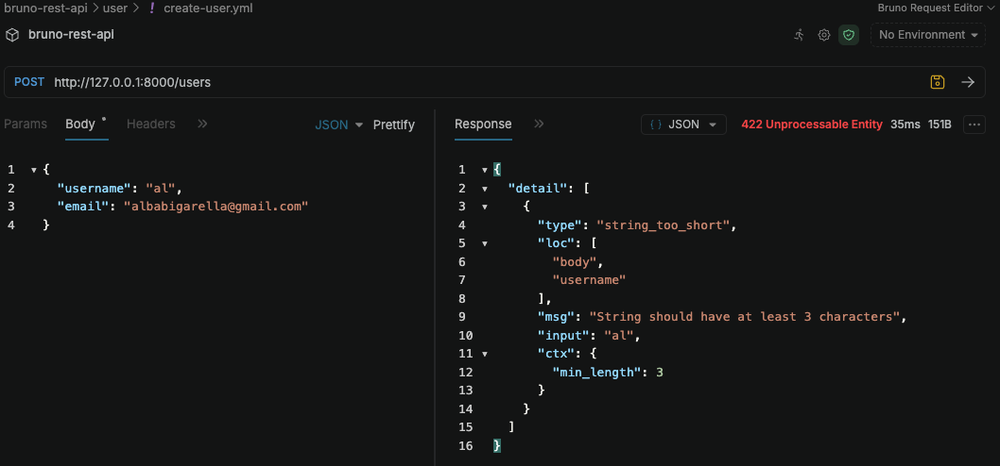

### 5.1.2. Listar usuarios

Se realiza una petición GET para obtener el listado de usuarios registrados, de manera que la API devuelve los usuarios almacenados en la base de datos.

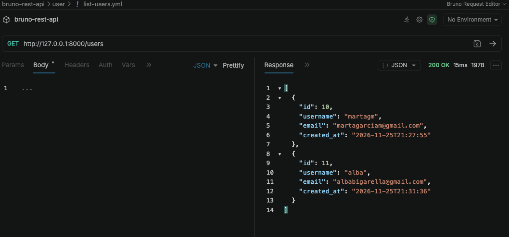

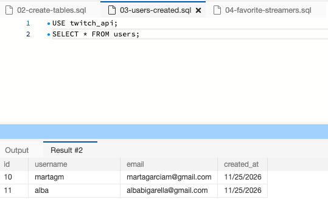

### 5.1.3. Consultar usuario

Se realiza una petición GET usando el id de un usuario para consultar su información individual.

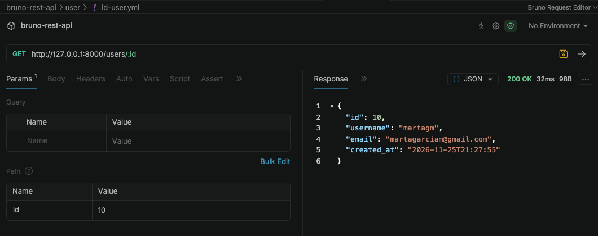

Si se realiza la misma petición utilizando un identificador que no existe la API devuelve una respuesta de error indicando que el usuario no se ha encontrado.

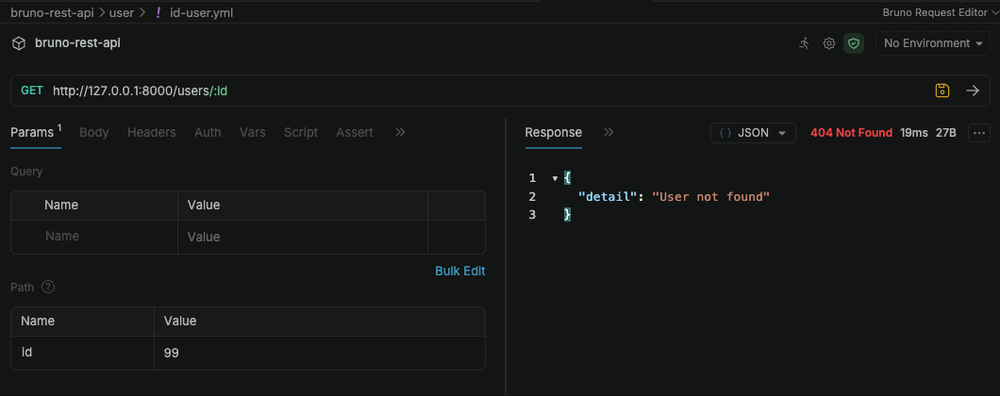

### 5.1.4. Actualizar usuario

Se realiza una petición PATCH para poder modificar parcialmente los datos de un usuario que ya existe.

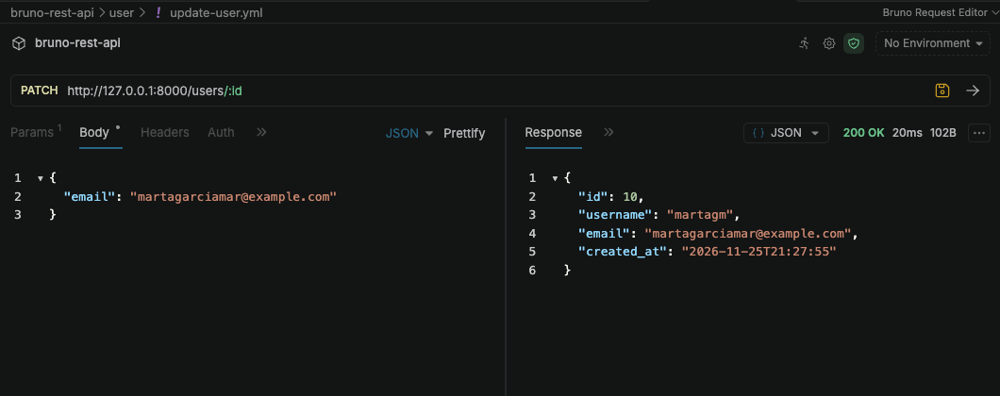

Si se realiza una petición PATCH sin incluir ningún campo para actualizar la API evita realizar una actualización sin cambios.

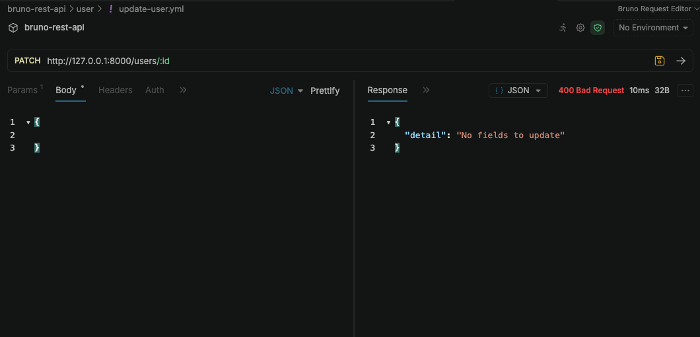

### 5.1.5. Borrar usuario

Si se realiza una petición DELETE utilizando el identificador del usuario que se desea eliminar el usuario desaparece de la base de datos y que la API devuelve la respuesta correspondiente.

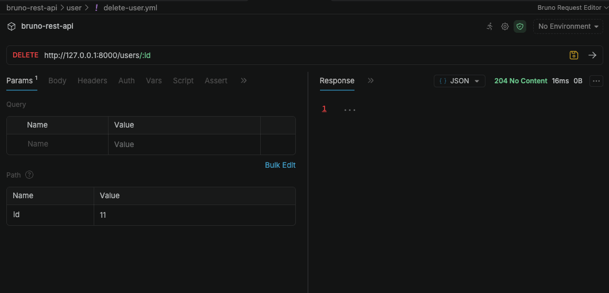

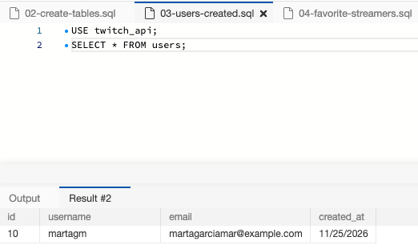

Si se intenta eliminar un usuario cuyo identificador no está registrado la API devuelve un error indicando que no existe el usuario solicitado.

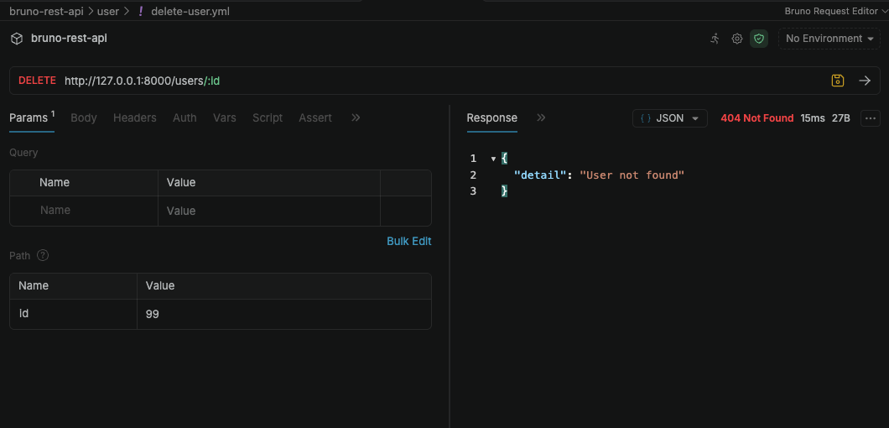

## 5.2. Gestión de streamers favoritos

### 5.2.1. Añadir favorito

Se realiza una petición POST para añadir un streamer a la lista de favoritos de un usuario, enviando el identificador del usuario y el nombre del streamer. Se verifica que el nuevo registro queda asociado al usuario correspondiente.

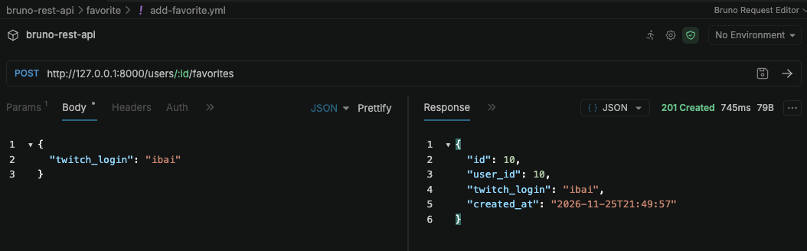

Si se intenta añadir nuevamente un streamer que ya está registrado como favorito del mismo usuario, la aplicación detecta que el favorito ya existe y devuelve error para duplicar el registro.

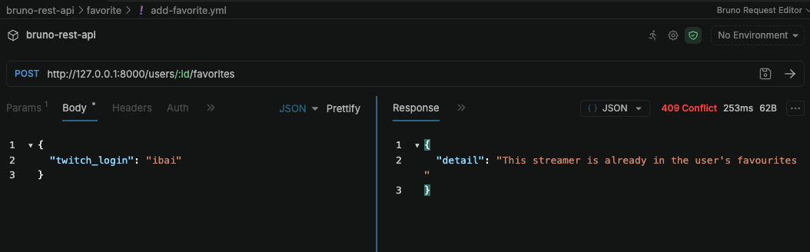

Si se intenta añadir un nombre de streamer que no existe en Twitch, la aplicación valida la existencia del streamer mediante la API externa y evita guardar ese favorito que no existe.

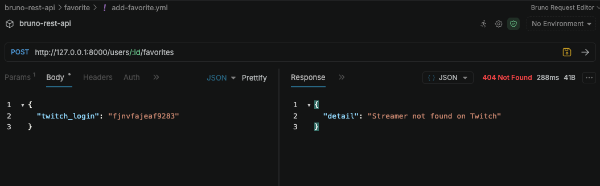

### 5.2.2. Listar favoritos

Se realiza una petición GET para consultar los streamers favoritos asociados a un usuario. Se comprueba que la API devuelve los favoritos almacenados y que estos pertenecen al usuario indicado.


### 5.2.3. Eliminar favorito

Se realiza una petición DELETE para eliminar un streamer de la lista de favoritos de un usuario. Se comprueba que el registro se elimina correctamente de la base de datos.

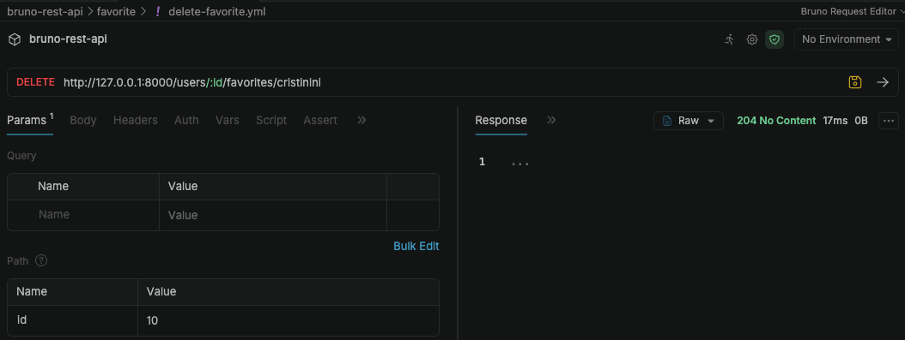

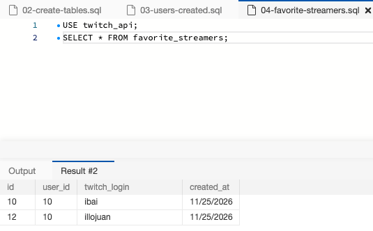

Si se intenta eliminar un streamer que no se encuentra en la lista de favoritos del usuario la API detecta que el registro no existe y devuelve el error correspondiente.

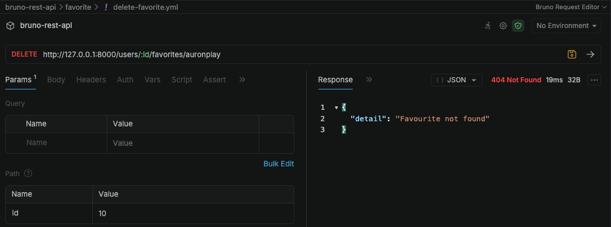

## 5.3. Consulta de información de streamers

En este apartado se comprueba la integración con la API oficial de Twitch. A diferencia de las operaciones anteriores, estas consultas permiten obtener información externa que no se almacena directamente en la base de datos de la aplicación.

### 5.3.1. Consultar información de un streamer

Se realiza una petición GET para obtener información de un streamer concreto. La aplicación consulta la API de Twitch y devuelve los datos que se pueden ver en el canal, como su identificador, nombre de usuario y nombre visible. También se comprueba si el streamer se encuentra en directo y, en ese caso, se obtiene la información correspondiente a su emisión, como el título o la categoría del juego.

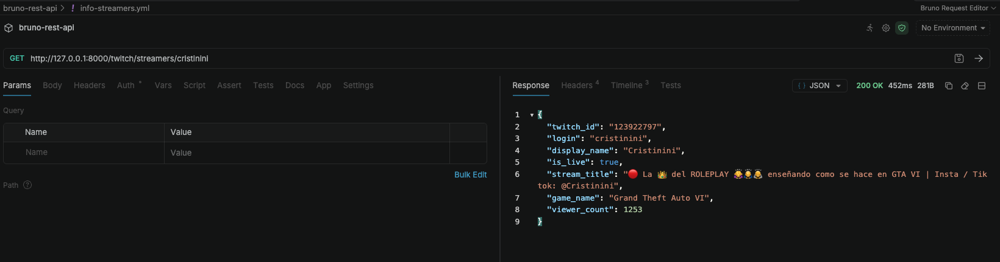

### 5.3.2. Consultar información de los streamers favoritos

Se realiza una petición para obtener información de los streamers favoritos de un usuario. La aplicación recupera primero los favoritos almacenados en MySQL y posteriormente consulta la información correspondiente en Twitch.

De esta forma, se obtiene una visión conjunta de los streamers que sigue cada usuario y de su estado actual en la plataforma. Se comprueba que la información devuelta corresponde a los favoritos registrados y que se identifica correctamente cuáles están en directo.

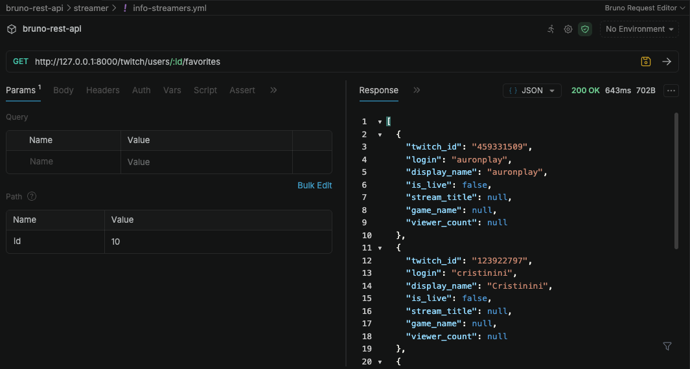

# 6. Observaciones

Durante el desarrollo se ha tenido en cuenta la organización del código, la seguridad y la integridad de los datos. Para ello, se ha separado la configuración del proyecto de la lógica de la aplicación. Esto permite gestionar las credenciales y los parámetros de conexión sin incluirlos directamente en los archivos de código.

También se ha utilizado Pydantic para validar los datos recibidos por la API. De esta manera, se evita que se procesen datos que no cumplen los requisitos establecidos, como direcciones de correo electrónico incorrectas o nombres de usuario que no respetan las restricciones definidas.

Por otro lado, las restricciones de la base de datos complementan las validaciones realizadas desde Python. Por ejemplo, las restricciones `UNIQUE` evitan duplicidades incluso si una petición llega a la base de datos sin haber sido filtrada previamente.

La integración con Twitch permite consultar información externa y complementar los datos almacenados localmente como indica la tarea. Es importante tener en cuenta que esta información depende de la disponibilidad de la API externa y de las credenciales configuradas.

Por último, se han realizado pruebas tanto de funcionamiento habitual como de situaciones de error para comprobar que la aplicación responde de forma controlada ante diferentes escenarios.

# 7. Conclusiones

El desarrollo de este proyecto ha permitido implementar una API REST utilizando Python y FastAPI, integrando una base de datos con MySQL y la API externa oficial de Twitch. 

Se han desarrollado las operaciones necesarias para gestionar usuarios y sus streamers favoritos, así como las consultas que permiten obtener información actualizada de los canales de Twitch. Además, se ha trabajado con la validación de datos mediante Pydantic, la gestión de errores HTTP, las relaciones entre tablas y la configuración de variables de entorno. Como validación, se ha utilizado Bruno y MySQL Workbench para verificar el funcionamiento de los diferentes endpoints.

En conjunto, el proyecto ha servido para poner en práctica conceptos relacionados con el desarrollo backend estudiados en clase, el diseño de APIs REST, la gestión de bases de datos y la integración de servicios externos, proporcionando una base sobre la que se podrían incorporar nuevas funcionalidades en el futuro.

## 8. Bibliografía y recursos utilizados

### 8.1. Documentación técnica

- **Python.** Documentación oficial del lenguaje de programación Python.  
  https://docs.python.org/3/

- **FastAPI.** Documentación oficial del framework utilizado para desarrollar la API REST.  
  https://fastapi.tiangolo.com/

- **Pydantic.** Documentación oficial de la biblioteca utilizada para la validación y estructuración de los datos.  
  https://docs.pydantic.dev/

- **MySQL.** Documentación oficial del sistema de gestión de bases de datos.  
  https://dev.mysql.com/doc/

- **MySQL Connector/Python.** Documentación oficial del conector utilizado para establecer la comunicación entre Python y MySQL.  
  https://dev.mysql.com/doc/connector-python/en/

- **Twitch Developers.** Documentación oficial de la API de Twitch, utilizada para consultar información de los streamers y su estado de conexión.  
  https://dev.twitch.tv/docs/

- **Requests.** Documentación de la biblioteca utilizada para realizar peticiones HTTP a la API de Twitch.  
  https://requests.readthedocs.io/

- **python-dotenv.** Documentación de la biblioteca utilizada para cargar las variables de entorno desde el archivo `.env`.  
  https://pypi.org/project/python-dotenv/

- **Bruno.** Documentación de la herramienta utilizada para realizar y comprobar las peticiones a los endpoints de la API.  
  https://docs.usebruno.com/

### 8.2. Uso de inteligencia artificial

Durante el desarrollo del proyecto se ha utilizado **ChatGPT, de OpenAI**, como herramienta de apoyo.

La inteligencia artificial se ha utilizado principalmente para:

- Resolver dudas generales relacionadas con Python, FastAPI, MySQL y el desarrollo de APIs REST previas al desarrollo.
- Comprender conceptos técnicos como los routers de FastAPI y la autenticación mediante tokens para la API de Twitch.
- Obtener ayuda para solucionar errores durante el desarrollo, los cuales fueron generalmente ortográficos.
- Obtener ayuda con MySQL Workbench para macOS.
- Mejorar la distribución de los archivos del proyecto.
- Mejorar la organización de la documentación del proyecto.

**Herramienta de inteligencia artificial utilizada:** ChatGPT (OpenAI), https://chatgpt.com/
